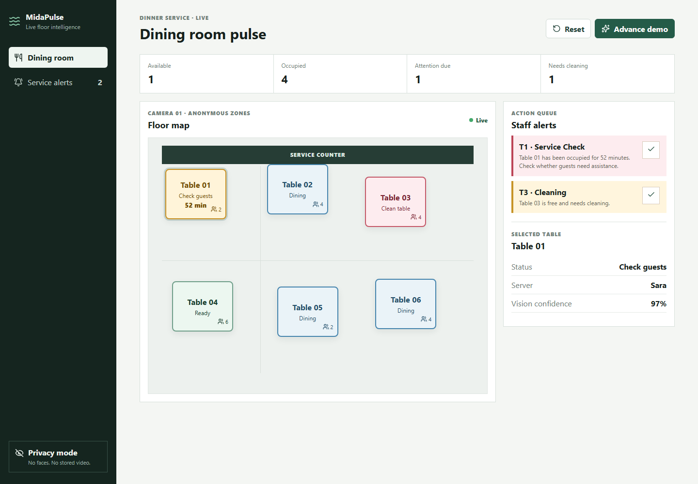
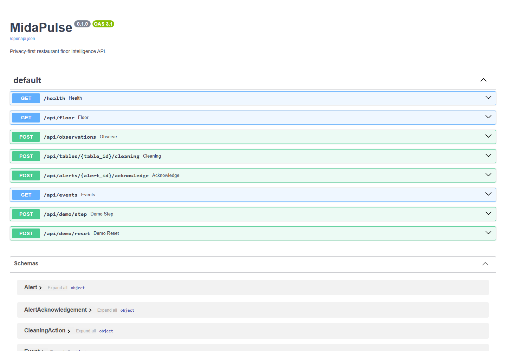

# MidaPulse

**Privacy-first restaurant floor intelligence.** MidaPulse turns anonymous camera observations into table states, service alerts, cleaning tasks, and operational metrics without facial recognition or stored video.

## Product preview

### Live floor operations



### Interactive API



## The problem

During a busy service, staff cannot continuously see which tables have waited longest, which guests may need attention, or which vacated tables still need cleaning. Existing reservation and POS systems know orders, but they often do not know the live physical state of the floor.

MidaPulse creates that missing operational layer.

## What makes it different

- A real table state machine instead of a generic camera counter.
- Edge processing: raw video remains on the restaurant device.
- No face recognition, identity tracking, or demographic inference.
- Configurable attention thresholds per table.
- Cleaning workflow from vacancy detection to ready state.
- Explainable event history and staff acknowledgement.
- Synthetic demo mode for safe, reproducible evaluation.

## MVP capabilities

- Six-zone dining-room configuration.
- Anonymous occupancy observations with confidence.
- `AVAILABLE_CLEAN`, `OCCUPIED`, `ATTENTION_DUE`, `VACATED_NEEDS_CLEANING`, and `CLEANING` states.
- Service-check, cleaning, and hygiene-override alerts.
- Live React/TypeScript floor dashboard.
- FastAPI API with SQLite event history.
- OpenCV edge worker that sends events rather than frames.
- Automated state, privacy-schema, API, and CORS tests.
- Docker Compose and GitHub Actions.

## Run locally

```bash
pip install -r backend/requirements.txt
uvicorn backend.app.main:app --reload --port 8100
```

In another terminal:

```bash
cd frontend
npm install
npm run dev -- --port 5174
```

Open http://127.0.0.1:5174 and press **Advance demo** to simulate a dinner service.

## Edge camera worker

The optional worker uses OpenCV's local people detector and maps anonymous person anchors to configured table zones.

```bash
pip install -r edge/requirements.txt
python edge/camera_worker.py --source 0 --api http://127.0.0.1:8100
```

The worker is an architectural proof, not a production-ready surveillance model. A real deployment requires camera calibration, restaurant-specific evaluation, explicit signage/consent review, and false-alert monitoring.

## Test

```bash
pytest backend/tests -q
cd frontend && npm run build
```

## Safety boundaries

- No facial recognition or biometric identification.
- No central storage of camera frames.
- No automated employee scoring.
- No automated decisions about guests.
- Staff can acknowledge and correct operational alerts.
- Synthetic data only in the public repository.

Read the [architecture](docs/architecture.md) and [privacy decision](docs/decisions/0001-no-biometric-identification.md).

## Roadmap

- Calibrated zone editor and recorded-video evaluation harness.
- WebSocket push notifications and PWA staff alerts.
- PostgreSQL/TimescaleDB event analytics.
- Shift workload balancing without employee performance scoring.
- Prometheus metrics and drift/false-alert dashboards.
- Edge deployment on NVIDIA Jetson or CPU-only mini PC.

## License

MIT
